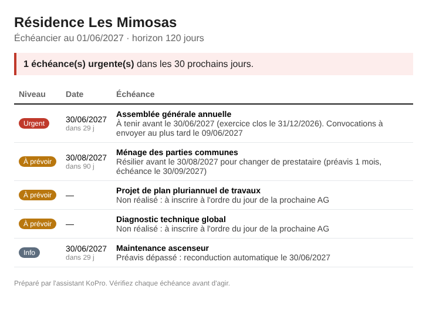
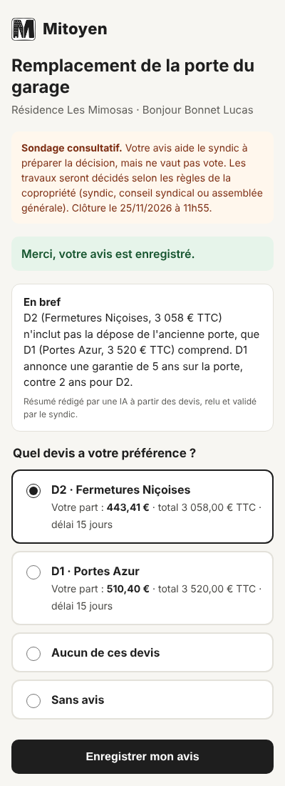
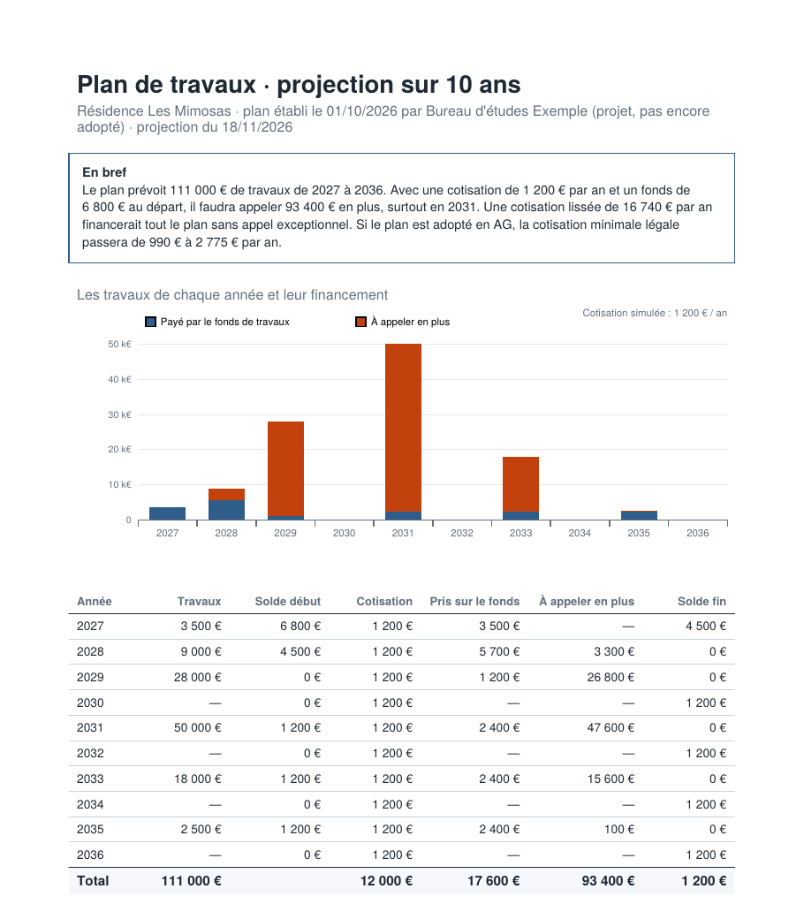

<p align="center">
  
</p>

# KoPro

> **KoPro, l'outil qui va mettre votre vieux syndic KO** 🥊

Un assistant open source pour les syndics **bénévoles et coopératifs** de copropriétés de moins de 50 lots.

**Principe : l'agent prépare, le syndic valide et signe.** L'outil assiste un syndic humain, il ne le remplace jamais.

> ⚠️ Projet en phase 1 (open source / portfolio). Toutes les données du dépôt sont **fictives**.

## Architecture

```
┌─────────────┐   HTTP + X-API-Key   ┌──────────────────────────┐
│    n8n      │ ───────────────────► │  moteur (Python/FastAPI) │
│ orchestrer, │ ◄─────────────────── │  valider, calculer,      │
│ mails,      │     JSON + PDF       │  générer les documents   │
│ validation  │                      │                          │
└─────────────┘                      └──────────────────────────┘
                                        ▲              │
                              config/*.yaml       out/<copro>/…
                              (une fiche par copro)  (avis, récaps)
```

| Dossier | Contenu |
|---|---|
| `config/` | Une fiche de configuration par copro. `mimosas.yaml` = copro démo fictive de 24 lots |
| `core/` | Le socle commun : validation de fiche, échéancier, appels de fonds, PDF |
| `moteur/` | L'API HTTP autour du socle, et son image Docker |
| `workflows/` | Les workflows n8n à importer |
| `tests/` | Tests du moteur |

## Démarrage rapide (Docker)

```bash
cp .env.example .env
# remplir MOTEUR_TOKEN et N8N_ENCRYPTION_KEY :
python -c "import secrets; print(secrets.token_urlsafe(32))"

mkdir -p out          # sous Linux : sudo chown 1000 out
docker compose up -d --build
```

- Documentation interactive du moteur : http://localhost:8000/docs (bouton *Authorize* → ta clé)
- n8n : http://localhost:5678

### Brancher le workflow dans n8n

1. **Import** : Workflows → *Import from File* → `workflows/appel_de_fonds.json`
2. **Identifiant « Moteur syndic »** : type *Header Auth*, nom `X-API-Key`, valeur = ton `MOTEUR_TOKEN`
3. **Identifiant « SMTP copro »** : ton serveur d'envoi de mails
4. **Nœud Config** : ton adresse dans `email_syndic`, et garde `mode_test = true` pour commencer

En mode test, **tous les mails arrivent chez le syndic**, préfixés `[TEST]`. Aucun copropriétaire ne reçoit rien.

### Les workflows disponibles

| Workflow | Déclenchement | Ce qu'il fait |
|---|---|---|
| `appel_de_fonds.json` | Manuel, chaque trimestre | Génère les avis, attend la validation du syndic, puis les envoie |
| `echeancier_hebdo.json` | Chaque lundi à 8h | Envoie à chaque syndic ses échéances : contrats à résilier, diagnostics, AG, fin de mandat |

<p align="center"></p>

## Sans Docker (développement)

```bash
pip install -r moteur/requirements.txt
python core/fiche_copro.py config/mimosas.yaml --date 2027-02-15     # contrôle + alertes
python core/avis_appel.py config/mimosas.yaml --trimestre 1          # avis en PROJET
MOTEUR_TOKEN=dev uvicorn moteur.api:app --reload                     # l'API
python tests/test_api.py                                             # les tests
```

## Routes du moteur

| Méthode | Route | Rôle |
|---|---|---|
| GET | `/sante` | Le moteur répond-il ? (sans clé) |
| GET | `/copros` | Fiches disponibles |
| GET | `/copros/{copro}/fiche?au=AAAA-MM-JJ` | Validation de la fiche + alertes de l'échéancier |
| GET | `/copros/{copro}/echeancier?au=&horizon=` | Échéances d'une copro : contrats, diagnostics, AG, mandat, avec niveau d'urgence |
| GET | `/echeancier?au=&horizon=` | Échéances de toutes les copros (workflow hebdomadaire) |
| GET | `/copros/{copro}/travaux` | Dossiers de travaux |
| POST | `/copros/{copro}/travaux` | Créer un dossier (titre, nature, urgence, clé) |
| GET | `/copros/{copro}/travaux/{id}` | Dossier + comparatif des devis + qui décide |
| POST | `/copros/{copro}/travaux/{id}/devis` | Ajouter un devis (formulaire + PDF) |
| GET | `/copros/{copro}/travaux/{id}/comparatif.pdf` | Comparatif PDF à joindre à une convocation |
| POST | `/copros/{copro}/travaux/{id}/resume` | Résumé IA des différences entre devis (brouillon) |
| PUT | `/copros/{copro}/travaux/{id}/resume` | Le syndic valide, et peut corriger, le résumé |
| POST | `/copros/{copro}/travaux/{id}/verifications` | Vérifie les entreprises : registre, BODACC, RGE, assurance décennale |
| POST | `/copros/{copro}/travaux/{id}/sondages` | Ouvre un sondage consultatif et renvoie un lien personnel par copropriétaire |
| GET | `/copros/{copro}/travaux/{id}/sondages/{s}` | Résultats du sondage (en voix et en nombre) |
| POST | `/copros/{copro}/travaux/{id}/ag` | Dépouillement d'AG : une résolution par devis, majorités art. 24, 25, 25-1, 26 |
| POST | `/copros/{copro}/travaux/{id}/conseil` | Vote du conseil syndical (délégation de pouvoirs) |
| GET | `/copros/{copro}/plan` | Plan de travaux : lignes et suivi, cotisation minimale légale, points de conformité |
| GET | `/copros/{copro}/plan/projection?cotisation=&indexation=` | Fonds de travaux sur 10 ans, cotisation lissée, quote-part de chaque copropriétaire |
| GET | `/copros/{copro}/plan.pdf?cotisation=&indexation=` | Projection PDF à joindre à la convocation d'AG |
| PUT | `/copros/{copro}/plan/lignes/{ligne}` | Avancement d'une ligne : reportée, réalisée (avec le montant payé), abandonnée |
| POST | `/copros/{copro}/plan/lignes/{ligne}/dossier` | Ouvre le dossier de travaux d'une ligne : devis, comparatif, vote |
| POST | `/copros/{copro}/appels/{exercice}/T{n}?final=false` | Génère avis + récap, renvoie la liste d'envoi |
| GET | `/copros/{copro}/appels/{exercice}/T{n}` | Relit la liste d'envoi |
| GET | `/copros/{copro}/appels/{exercice}/T{n}/recap` | PDF de la récap à signer |
| GET | `/copros/{copro}/appels/{exercice}/T{n}/avis/{id}` | PDF d'un avis |

## Travaux et devis

Pour une intervention non prévue, le syndic ouvre un **dossier de travaux** et y dépose plusieurs devis en PDF. KoPro :

- **compare les devis** : montants TTC, écarts avec le moins cher, délais, devis expirés ou incomplets ;
- **calcule la quote-part de chaque copropriétaire** pour chaque devis, au centime, selon la clé de répartition ;
- **indique qui peut décider** (syndic seul, urgence, conseil syndical par délégation, ou AG) à partir des seuils votés en AG et inscrits dans la fiche ;
- **produit un comparatif PDF** à joindre à la convocation ou à diffuser aux copropriétaires.

### La vérification des entreprises

Pour chaque devis, KoPro vérifie l'entreprise à partir de **sources publiques françaises, gratuites et sans clé** :

| Vérification | Source |
|---|---|
| SIRET présent et valide (clé de contrôle) | Le devis lui-même |
| Entreprise active ou fermée, date de création, label RGE | [API Recherche d'entreprises](https://annuaire-entreprises.data.gouv.fr) |
| Procédures collectives (sauvegarde, redressement, liquidation) sur 5 ans | [BODACC](https://www.bodacc.fr) |
| Mention d'une assurance décennale | Le devis lui-même |

Les constats figurent dans le comparatif PDF et sont transmis à l'IA pour le résumé. Une source injoignable est signalée comme « non consultée », jamais présentée comme un résultat rassurant. KoPro ne reprend aucun avis en ligne : seuls des registres officiels sont consultés.

### Le résumé IA des devis

Pour les copropriétaires qui n'ont pas le temps de lire trois devis, KoPro peut faire rédiger par **Mistral** (IA française, hébergée en Europe) un résumé de 2 ou 3 phrases sur ce qui distingue les devis : prix, prestations incluses ou exclues, garanties, délais, validité, assurance.

- **Neutre** : l'IA décrit, elle ne recommande jamais. Une formulation de recommandation bloque la validation.
- **Fidèle** : elle ne s'appuie que sur le texte des devis. Un montant qui n'y figure pas est signalé, et une information absente est dite « non précisée ».
- **Protégée** : le texte des devis est traité comme une donnée. Une consigne glissée dans un devis est ignorée.
- **Validée** : le résumé est un brouillon jusqu'à ce que le syndic le relise, le corrige si besoin et le valide. Il devient obsolète si un devis est ajouté.

Le texte des devis est envoyé à Mistral pour l'analyse. Activation : `MISTRAL_API_KEY` dans `.env`.

**Démonstration** : avec le moteur lancé, `bash scripts/demo_travaux.sh` crée un dossier sur la copro fictive, dépose les 3 devis d'exemple de `exemples/devis/`, demande le résumé à Mistral puis télécharge le comparatif PDF.

> ⚖️ En copropriété, la plupart des travaux se décident en assemblée générale. L'aiguillage de KoPro est indicatif et ne remplace pas l'avis d'un juriste ou de l'ADIL. Le vote (sondage consultatif, conseil syndical, dépouillement d'AG) est décrit plus bas.

### Le vote

| Usage | Qui vote | Règle |
|---|---|---|
| **Sondage consultatif** | Chaque copropriétaire, par un lien personnel | Avis en tantièmes, sans valeur de décision |
| **Conseil syndical** | Les membres du conseil, une voix chacun | Majorité des membres, dans la limite de la délégation votée en AG |
| **Assemblée générale** | Présents, représentés, votes par correspondance | Art. 24 (voix exprimées), 25 (toutes les voix), 25-1 (second vote), 26 (double majorité) |

Pour plusieurs devis, chaque devis fait l'objet d'une résolution, votées dans l'ordre : la première adoptée l'emporte. Les voix suivent la clé de répartition du dossier (seuls les copropriétaires concernés votent les charges spéciales) et la réduction de l'article 22 s'applique. Les liens de vote ne sont jamais stockés en clair.

<p align="center"></p>

> Le calcul est une aide : seul le procès-verbal d'AG signé fait foi.

## Le plan de travaux vivant

Depuis 2025, toute copropriété de plus de 15 ans doit disposer d'un projet de plan pluriannuel de travaux (article 14-2 de la loi de 1965) : la liste des travaux à prévoir sur 10 ans, leur coût estimé et leur priorité. Chez un syndic classique, ce document finit dans un tiroir. KoPro s'en sert pour piloter la copropriété :

| Question | Ce que calcule KoPro |
|---|---|
| **Le fonds de travaux suffira-t-il ?** | Projection année par année : ce que le fonds paie, ce qu'il faudra appeler en plus, le solde restant |
| **Quel minimum légal ?** | 5 % du budget prévisionnel et, une fois le plan adopté en AG, 2,5 % du montant de ses travaux |
| **Quelle cotisation pour éviter les appels exceptionnels ?** | La cotisation annuelle constante qui finance tout le plan (« cotisation lissée ») |
| **Combien pour moi, et quand ?** | La quote-part de chaque copropriétaire, année par année, selon la clé de chaque ligne |
| **Sommes-nous en règle ?** | Plan à présenter ou à actualiser, DPE collectif, travaux en retard |

Le plan voté reste dans la fiche (`plan_travaux` dans `config/<copro>.yaml`). Son suivi (dossier ouvert, travaux réalisés, report) est tenu dans `data/`. Quand une ligne arrive à échéance, l'échéancier la signale ; un appel à l'API ouvre le dossier de travaux correspondant, et le circuit devis → comparatif → vote prend le relais. Le comparatif signale alors tout devis qui dépasse de plus de 20 % l'estimation du plan.

<p align="center"></p>

> Projection indicative, établie à partir des estimations du plan, hors aides et hors intérêts du compte. Elle ne remplace ni l'avis d'un professionnel ni celui de l'ADIL.

## Données personnelles

- Les fiches des vraies copros et le dossier `out/` sont exclus du dépôt (`.gitignore`).
- Le moteur n'est exposé que sur `127.0.0.1` et sur le réseau interne Docker.
- En production : hébergement en Europe, HTTPS, sauvegardes chiffrées.

## Comment ce projet est construit

KoPro est développé avec l'aide d'une IA (Claude, d'Anthropic), qui a écrit une grande partie du code.
Mon rôle : définir le besoin et le périmètre, choisir le cadre juridique et l'architecture,
tester, déployer et faire évoluer l'outil. Chaque brique est relue, testée et documentée avant publication.

## Licence

AGPL-3.0.
