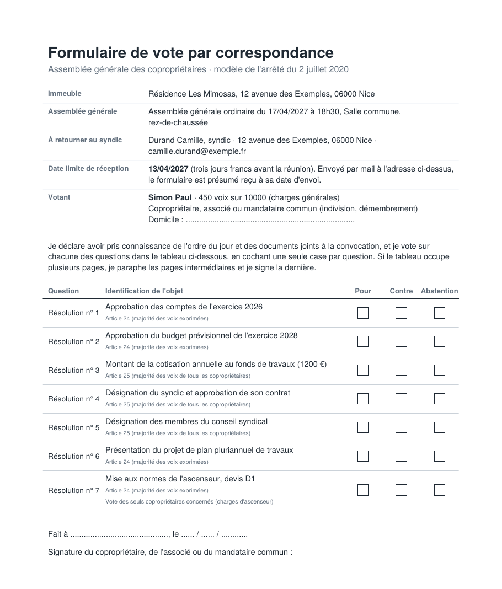

# L'assemblée générale sans papier

[← Retour à l'accueil](../README.md)

Mitoyen prépare toute l'assemblée générale, du calendrier au procès-verbal, dans le respect de la loi du 10 juillet 1965 et du décret du 17 mars 1967 :

| Étape | Ce que fait Mitoyen |
|---|---|
| **Calendrier** | Dates limites de convocation (21 jours), de réception des votes par correspondance (3 jours francs), de notification du procès-verbal (1 mois) ; alerte si l'AG annuelle dépasse les 6 mois après la clôture |
| **Vote par correspondance** | Un formulaire pré-rempli par copropriétaire, sur la structure du modèle de l'arrêté du 2 juillet 2020 ; les formulaires arrivés hors délai sont refusés |
| **Convocations** | Le registre des envois vérifie que chaque copropriétaire a été convoqué à temps |
| **Présences et mandats** | Présents, visio, représentés ; le syndic ne peut pas recevoir de mandat, et au-delà de 3 mandats le total ne doit pas dépasser 10 % des voix |
| **Feuille de présence** | Avec la date de réception de chaque formulaire ; celui d'un copropriétaire finalement présent est écarté |
| **Dépouillement** | En séance, on note qui vote contre et qui s'abstient ; une résolution amendée transforme le « pour » par correspondance en défaillance ; majorités 24, 25, 25-1 et 26, clés spéciales |
| **Procès-verbal** | Brouillon avec les noms et les voix des opposants, abstentionnistes et défaillants, et la liste des copropriétaires à qui le notifier |

> Le formulaire reprend la structure et les mentions du modèle officiel : avant un usage réel, comparez-le à l'annexe de l'arrêté du 2 juillet 2020 sur Légifrance. Une case laissée vide n'est pas comptée et signalée au bureau, la loi ne disant pas comment la traiter. Le procès-verbal signé reste la seule référence.
