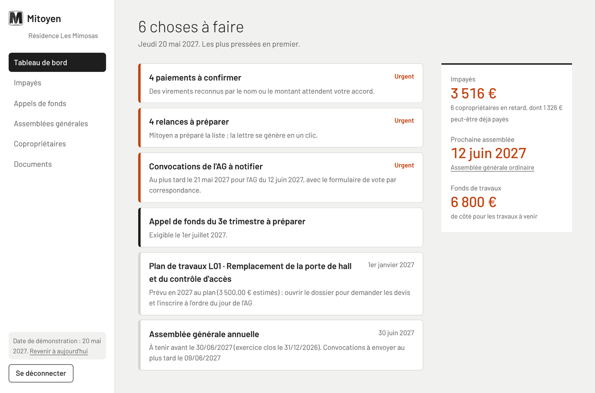
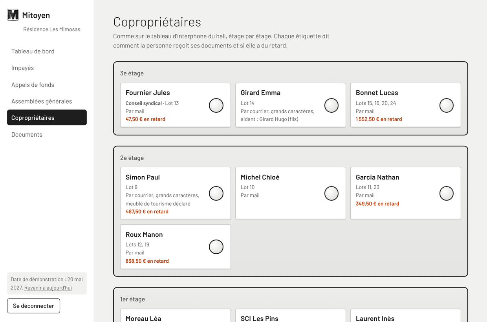

# L'interface du syndic

[← Retour à l'accueil](../README.md)

Le moteur sert aussi une interface web, à l'adresse `/app`. Pas d'application à installer : un navigateur suffit, sur ordinateur, tablette ou téléphone.

<p align="center"></p>

## Les écrans

| Écran | Ce qu'on y fait |
|---|---|
| **Tableau de bord** | La liste de ce qui est à faire, du plus urgent au moins pressé, rédigée en phrases : paiements à confirmer, relances à préparer, convocations à notifier, appel de fonds à préparer, contrats et diagnostics. À côté, trois chiffres : impayés, prochaine AG, fonds de travaux |
| **Impayés** | Importer le relevé bancaire ; rattacher un paiement ou l'écarter en un clic ; préparer une relance, l'ouvrir, la marquer envoyée |
| **Appels de fonds** | Les quatre trimestres de l'exercice : préparer le projet, relire le récapitulatif, valider les avis |
| **Assemblées générales** | Préparer une AG (l'ordre du jour habituel est proposé), voir son calendrier légal, ouvrir les formulaires de vote, la feuille de présence, le procès-verbal |
| **Copropriétaires** | Présentés étage par étage, comme sur le tableau d'interphone du hall : lots, mail ou courrier, grands caractères, aidant, retard éventuel |
| **Documents** | Affiche du hall, fiche synthétique, plan de travaux, packs de bienvenue, dossier de vente, déclarations de meublés de tourisme |

<p align="center"></p>

## Choix de conception

- **Deux polices, deux publics.** L'outil du syndic utilise Barlow, inspirée de la signalétique : fine, nette, en 16 px. Ce que voient les copropriétaires (la page de vote en ligne) utilise Atkinson Hyperlegible, dessinée pour les personnes malvoyantes.
- **La charte des documents.** Le noir du logo, du blanc, un gris pierre ; l'orange est réservé aux chiffres importants, comme sur les PDF.
- **Rien d'externe.** Les polices et htmx (qui rend les boutons actifs sans recharger la page) sont servis par l'application elle-même : aucun appel à un service tiers.
- **Le même principe que le moteur.** L'interface ne fait rien que le syndic n'ait demandé : elle prépare, il valide.

## Connexion et sécurité

| Réglage (`.env`) | Rôle |
|---|---|
| `INTERFACE_MOT_DE_PASSE` | Le mot de passe du syndic. Vide : `MOTEUR_TOKEN` sert de mot de passe |
| `INTERFACE_HTTPS` | `1` en production derrière HTTPS : le cookie de session n'est alors envoyé qu'en HTTPS |
| `INTERFACE_SECRET` | Facultatif : la clé qui signe les sessions (sinon dérivée de `MOTEUR_TOKEN`) |

La connexion ouvre une session signée de 8 heures. Elle donne accès aux mêmes routes que la clé d'API, ce qui permet d'ouvrir les PDF depuis l'interface. Le cookie est en `SameSite=Lax` : un formulaire posté depuis un autre site n'emporte pas la session.

## Essayer

```bash
python scripts/demo_interface.py
MOTEUR_DATA_DIR=demo/data MOTEUR_OUT_DIR=demo/out INTERFACE_MOT_DE_PASSE=demo uvicorn moteur.api:app --reload
```

Ouvrir http://localhost:8000/app/mimosas?au=2027-05-20, mot de passe `demo`. Le paramètre `au` fixe la date de la démonstration : au 20 mai 2027, des paiements attendent confirmation, des relances sont à préparer et les convocations de l'AG du 12 juin doivent partir. Un lien dans la barre latérale ramène à la date du jour.

## Ce qui viendra

Les travaux et le plan pluriannuel restent pour l'instant accessibles par l'API. La tenue de séance d'AG sur tablette et le suivi de chantier feront partie d'une offre complémentaire.
