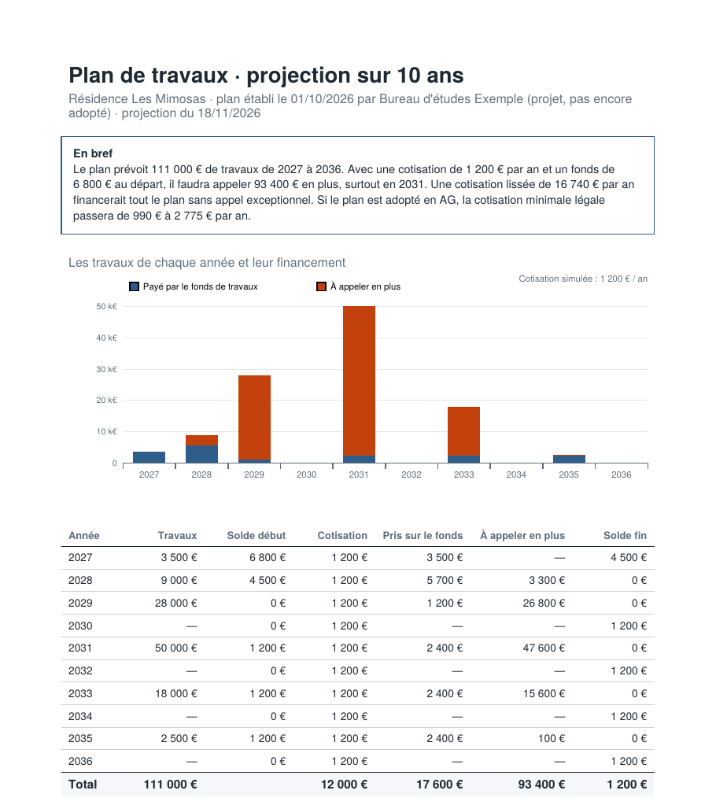

# Le plan de travaux vivant

[← Retour à l'accueil](../README.md)

Depuis 2025, toute copropriété de plus de 15 ans doit disposer d'un projet de plan pluriannuel de travaux (article 14-2 de la loi de 1965) : la liste des travaux à prévoir sur 10 ans, leur coût estimé et leur priorité. Chez un syndic classique, ce document finit dans un tiroir. Mitoyen s'en sert pour piloter la copropriété :

| Question | Ce que calcule Mitoyen |
|---|---|
| **Le fonds de travaux suffira-t-il ?** | Projection année par année : ce que le fonds paie, ce qu'il faudra appeler en plus, le solde restant |
| **Quel minimum légal ?** | 5 % du budget prévisionnel et, une fois le plan adopté en AG, 2,5 % du montant de ses travaux |
| **Quelle cotisation pour éviter les appels exceptionnels ?** | La cotisation annuelle constante qui finance tout le plan (« cotisation lissée ») |
| **Combien pour moi, et quand ?** | La quote-part de chaque copropriétaire, année par année, selon la clé de chaque ligne |
| **Sommes-nous en règle ?** | Plan à présenter ou à actualiser, DPE collectif, travaux en retard |

Le plan voté reste dans la fiche (`plan_travaux` dans `config/<copro>.yaml`). Son suivi (dossier ouvert, travaux réalisés, report) est tenu dans `data/`. Quand une ligne arrive à échéance, l'échéancier la signale ; un appel à l'API ouvre le dossier de travaux correspondant, et le circuit devis → comparatif → vote prend le relais. Le comparatif signale alors tout devis qui dépasse de plus de 20 % l'estimation du plan.

> Projection indicative, établie à partir des estimations du plan, hors aides et hors intérêts du compte. Elle ne remplace ni l'avis d'un professionnel ni celui de l'ADIL.
