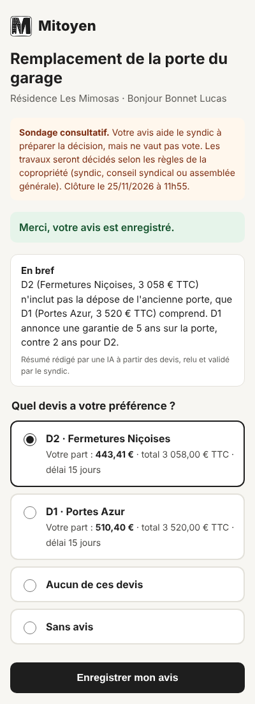

# Travaux, devis et vote

[← Retour à l'accueil](../README.md)

## Le dossier de travaux

Pour une intervention non prévue, le syndic ouvre un **dossier de travaux** et y dépose plusieurs devis en PDF. Mitoyen :

- **compare les devis** : montants TTC, écarts avec le moins cher, délais, devis expirés ou incomplets ;
- **calcule la quote-part de chaque copropriétaire** pour chaque devis, au centime, selon la clé de répartition ;
- **indique qui peut décider** (syndic seul, urgence, conseil syndical par délégation, ou AG) à partir des seuils votés en AG et inscrits dans la fiche ;
- **produit un comparatif PDF** à joindre à la convocation ou à diffuser aux copropriétaires.

## La vérification des entreprises

Pour chaque devis, Mitoyen vérifie l'entreprise à partir de **sources publiques françaises, gratuites et sans clé** :

| Vérification | Source |
|---|---|
| SIRET présent et valide (clé de contrôle) | Le devis lui-même |
| Entreprise active ou fermée, date de création, label RGE | [API Recherche d'entreprises](https://annuaire-entreprises.data.gouv.fr) |
| Procédures collectives (sauvegarde, redressement, liquidation) sur 5 ans | [BODACC](https://www.bodacc.fr) |
| Mention d'une assurance décennale | Le devis lui-même |

Une source injoignable est signalée comme « non consultée », jamais présentée comme un résultat rassurant. Aucun avis en ligne n'est repris : seuls des registres officiels sont consultés.

## Le résumé IA des devis

Pour les copropriétaires qui n'ont pas le temps de lire trois devis, Mitoyen peut faire rédiger par **Mistral** (IA française, hébergée en Europe) un résumé de 2 ou 3 phrases sur ce qui distingue les devis : prix, prestations incluses ou exclues, garanties, délais, validité, assurance.

- **Neutre** : l'IA décrit, elle ne recommande jamais. Une formulation de recommandation bloque la validation.
- **Fidèle** : elle ne s'appuie que sur le texte des devis. Un montant qui n'y figure pas, un classement de prix inexact ou une affirmation fausse sur la garantie décennale bloquent la validation.
- **Protégée** : le texte des devis est traité comme une donnée. Une consigne glissée dans un devis est ignorée.
- **Validée** : le résumé reste un brouillon jusqu'à ce que le syndic le relise, le corrige si besoin et le valide. Il devient obsolète si un devis est ajouté.

## Le vote

| Usage | Qui vote | Règle |
|---|---|---|
| **Sondage consultatif** | Chaque copropriétaire, par un lien personnel ou un bulletin papier | Avis en tantièmes, sans valeur de décision |
| **Conseil syndical** | Les membres du conseil, une voix chacun | Majorité des membres, dans la limite de la délégation votée en AG |
| **Assemblée générale** | Présents, représentés, votes par correspondance | Art. 24 (voix exprimées), 25 (toutes les voix), 25-1 (second vote), 26 (double majorité) |

Pour plusieurs devis, chaque devis fait l'objet d'une résolution, votées dans l'ordre : la première adoptée l'emporte. Les voix suivent la clé de répartition du dossier (seuls les copropriétaires concernés votent les charges spéciales) et la réduction de l'article 22 s'applique. Les liens de vote ne sont jamais stockés en clair.

> En copropriété, la plupart des travaux se décident en assemblée générale. L'aiguillage et le calcul des votes sont des aides : ils ne remplacent ni l'avis d'un juriste ou de l'ADIL, ni le procès-verbal d'AG signé.
